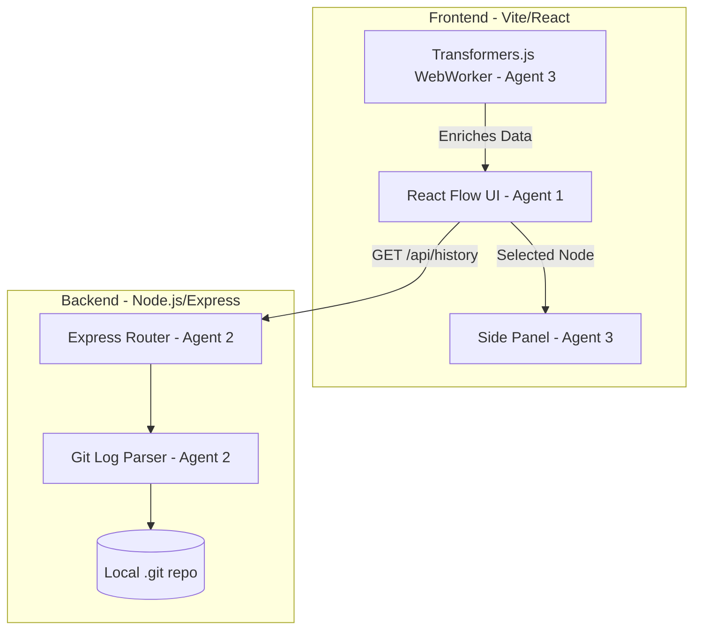

# GitStory (HackNotts)

> An interactive codebase visualizer that turns standard Git logs into an explorable node graph, sizing commits by impact and categorising them using local AI.

## Table of Contents

1. [Executive Overview](#1-executive-overview)
2. [Project Brief](#2-project-brief)
3. [Architecture & Shared Contracts](#3-architecture--shared-contracts)
4. [Workstream Ownership](#4-workstream-ownership)
5. [Parallel Execution Plan](#5-parallel-execution-plan)
6. [Agent Prompts](#6-agent-prompts)
7. [Master Timeline](#7-master-timeline)
8. [Testing & Launch Checklist](#8-testing--launch-checklist)
9. [Risk Register](#9-risk-register)
10. [Operating Instructions](#10-operating-instructions)

---

## 1. Executive Overview

GitStory is a local developer tool that parses a Git repository and visualises its commit history as an interactive, explorable graph. To comply with HackNotts' strict rules against cloud-based LLM wrapper apps, it relies entirely on local processing:

- **Backend:** Node.js executing native `git` commands
- **Frontend:** React Flow for rendering
- **AI:** Transformers.js running a local ML model in the browser to categorise commits

The three-agent parallel strategy splits work along strict architectural boundaries to avoid merge conflicts:

| Agent | Area | Owns |
|-------|------|------|
| **Agent 1** | Frontend & Graph UX | React Vite app, React Flow implementation, overall UI |
| **Agent 2** | Backend & Parsing | Node.js Express server, `child_process` execution, raw Git output parsing |
| **Agent 3** | AI & Capability | Local Transformers.js zero-shot classification pipeline, commit details side panel |

---

## 2. Project Brief

| | |
|---|---|
| **Product name** | GitStory |
| **Elevator pitch** | An interactive codebase visualizer that turns standard Git logs into an explorable node graph, sizing commits by impact and categorising them using local AI. |
| **Target audience** | Developers onboarding to new projects or reviewing long pull requests. |
| **Main pain point** | Terminal `git log` output and flat GitHub histories obscure the true architectural impact and intent of commits. |
| **USP** | Node size is bound to lines changed ("impact radius"), and commits are auto-categorised via in-browser ML without external APIs. |
| **Demo objective** | A slick 60-second visual playback of a repo growing, with massive refactors as giant nodes and bug fixes colour-coded automatically. |

### Core User Journey

1. **User** starts the local Node server in a target Git directory and opens the React app.
2. **Frontend** shows a loading state while fetching `/api/history`.
3. **Backend** runs `git log`, parses hashes, parents, metadata and lines changed, and returns a JSON array.
4. **Frontend (AI)** passes commit messages to the Transformers.js WebWorker to classify them (Bug, Feature, Refactor) and updates local state.
5. **Frontend (Graph)** renders the React Flow graph. Nodes are sized by line changes and coloured by AI classification.
6. **User** clicks a node.
7. **Frontend** slides out a side panel showing author, date, raw message and AI category.

### MVP Definition

| Priority | Scope |
|----------|-------|
| **P0 – Essential** | Backend parses `git log` into JSON. Frontend renders a basic React Flow graph connecting parents to children. |
| **P1 – High impact** | Backend parses `git log --stat` for `linesAdded` / `linesDeleted`. Frontend maps this to node size. |
| **P2 – Optional** | Local Transformers.js classification to colour-code nodes. A "Play" button to render nodes chronologically. |

**Non-goals:** no authentication, no database (in-memory/local only), no cloud LLM APIs, no write operations (read-only visualisation).

---

## 3. Architecture & Shared Contracts



### API Contract

All agents must strictly adhere to this JSON schema. The backend serves it, the frontend consumes it, and the AI appends to it.

**`GET /api/history`** — fetches the full parsed commit history.

Response (`200 OK`):

```json
[
  {
    "id": "a1b2c3d",
    "parents": ["f9e8d7c"],
    "author": "Sreyas S",
    "date": "2026-10-24T12:00:00Z",
    "message": "Initial commit",
    "linesAdded": 50,
    "linesDeleted": 0,
    "aiCategory": null
  }
]
```

> `aiCategory` is initialised as `null` by the backend and populated asynchronously by the frontend Transformers.js worker.

### Integration Rules

- **Ports:** backend on `:3001`, frontend on Vite default `:5173`.
- **File ownership:**
  - Agent 1: `client/src/components/Graph.jsx`, `App.jsx`
  - Agent 2: `server/index.js`, `server/parser.js`
  - Agent 3: `client/src/components/SidePanel.jsx`, `client/src/workers/aiWorker.js`

---

## 4. Workstream Ownership

| Feature | Owner | Dependencies | Acceptance Criteria |
|---------|-------|--------------|---------------------|
| Node.js server setup | Agent 2 | None | Runs on 3001, serves basic 200 OK health check. |
| Git log parsing | Agent 2 | None | Executes `git log` natively, handles merge commits (multiple parents), returns shared-contract JSON. |
| React app scaffolding | Agent 1 | None | Vite app runs, React Flow canvas fills the screen. |
| Graph rendering | Agent 1 | Agent 2 (or mock) | JSON maps to nodes/edges. Parent-child arrows render correctly using dagre layout. |
| Impact radius (sizing) | Agent 1 | Agent 2 | Node styling scales with `linesAdded + linesDeleted`. |
| Local AI classification | Agent 3 | None | Transformers.js loads a lightweight zero-shot model (e.g. `Xenova/mobilebert-uncased-mnli`) and categorises text. |
| Side panel UI | Agent 3 | Agent 1 (click event) | Clicking a node opens a polished side panel with commit metadata. |

---

## 5. Parallel Execution Plan

### Phase 1: Shared Foundation (Hours 0–1)
- Initialise repo, create `server/` and `client/` directories.
- **Agent 1** scaffolds Vite + React Flow with a hardcoded `mockData.json` using the shared contract.
- **Agent 2** initialises Express and writes the empty `GET /api/history` controller.

### Phase 2: Parallel Implementation (Hours 1–5)
- **Agent 1:** auto-layout logic using dagre (top-to-bottom or left-to-right).
- **Agent 2:** regex and `child_process` logic to parse `git log --pretty=format:"%H|%P|%an|%ad|%s" --numstat`.
- **Agent 3:** WebWorker for Transformers.js (avoids UI freezing while the model loads) and the `<SidePanel />` component.

### Phase 3: Early Integration (Hours 5–7)
- **Agent 1** removes `mockData.json` and fetches from `localhost:3001/api/history`.
- **Agent 3** hooks the AI classifier into Agent 1's state, updating node colours as inferences complete.

### Phase 4: Feature Completion & Polish (Hours 7–15)
- "Time-Lapse" playback slider (Agent 1).
- Refine regex for weird commit messages (Agent 2).
- Polish CSS, empty states and loading spinners (Agents 1 & 3).

### Phase 5: Feature Freeze (Hour 16)
- No new features. Bug fixes, presentation prep and testing on different repos only.

---

## 6. Agent Prompts

### Agent 1 — Frontend & Graph UX

~~~text
You are the Lead Frontend Engineer (Agent 1) for a 24-hour hackathon project named "GitStory".

PRODUCT OVERVIEW:
GitStory is a local developer tool that visualizes a Git repository's commit history as an interactive React Flow graph. The node sizes represent lines of code changed, and the node colors represent the commit intent (determined locally via AI by Agent 3).
Target user: Developers onboarding to complex codebases.
Differentiator: Visualizing "impact radius" and chronological history visually.

YOUR ROLE & BOUNDARIES:
You own the Vite + React frontend, specifically the Graph UI.
You are responsible for:
1. Setting up React Flow and `dagre` for automated directed-graph layout.
2. Fetching data from the backend contract and mapping it to React Flow `nodes` and `edges`.
3. Scaling node dimensions based on `linesAdded` + `linesDeleted`.
4. Emitting an `onNodeClick` event that Agent 3 will use to open a side panel.

SHARED CONTRACT (API /api/history):
You must build against this exact JSON schema:
[
  {
    "id": "a1b2c3d",
    "parents": ["f9e8d7c"], // Array of strings. Note: can be empty (initial commit) or multiple (merge).
    "author": "Sreyas S",
    "date": "2026-10-24T12:00:00Z",
    "message": "Initial commit",
    "linesAdded": 50,
    "linesDeleted": 0,
    "aiCategory": null // Will be mutated later by Agent 3
  }
]

DEPENDENCIES & PARALLEL WORK:
- Agent 2 is building the Express backend. Until they finish, use a hardcoded `mockData.json` file containing the schema above.
- Agent 3 is building a `<SidePanel />` and a Transformers.js WebWorker. Leave a placeholder slot in your `App.jsx` layout for the SidePanel.

PRIORITISED TASKS:
1. Scaffold the basic React Flow canvas.
2. Write a mapping function: `id` becomes node ID. `parents` array maps to edge sources/targets.
3. Integrate `dagre` to auto-position the nodes so it looks like a Git tree (handling branches).
4. Create a custom Node component that scales in size based on the lines changed.

ACCEPTANCE CRITERIA:
- The graph renders without overlapping nodes.
- Multiple branches and merge commits render correctly.
- The UI handles up to 500 nodes smoothly.

CONSTRAINTS:
- Do not build the backend logic.
- Prioritize a working, polished demo over minor optimizations.
- Format your response as a status report: [Completed], [Files Changed], [Next Actions], [Blockers]. Provide complete, usable React components.
~~~

### Agent 2 — Backend & Parsing

~~~text
You are the Lead Backend Engineer (Agent 2) for a 24-hour hackathon project named "GitStory".

PRODUCT OVERVIEW:
GitStory is a local developer tool that visualizes a Git repository's commit history.
Target user: Developers onboarding to complex codebases.
Differentiator: Replaces reading terminal output with a visual timeline.

YOUR ROLE & BOUNDARIES:
You own the Node.js Express server.
You are responsible for:
1. Setting up a local Express server on port 3001.
2. Executing native Git commands against a local directory using `child_process.exec`.
3. Parsing the raw stdout text into a clean JSON array.
4. Exposing this via `GET /api/history`.

SHARED CONTRACT (API /api/history):
You must output this exact JSON schema:
[
  {
    "id": "a1b2c3d",
    "parents": ["f9e8d7c"], // Array of strings. Empty for initial commit. Multiple for merges.
    "author": "Sreyas S",
    "date": "2026-10-24T12:00:00Z",
    "message": "Initial commit",
    "linesAdded": 50,
    "linesDeleted": 0,
    "aiCategory": null // Always return null. Agent 3 will populate this on the frontend.
  }
]

DEPENDENCIES & PARALLEL WORK:
- Agent 1 is building the frontend based on this contract. You must not change the JSON schema without full team agreement.

PRIORITISED TASKS:
1. Initialize Express and CORS.
2. Write a Git service that runs `git log --pretty=format:"%H|%P|%an|%ad|%s"`.
3. Write parsing logic to split the output by newlines and pipes (`|`). Handle merge commits (where `%P` returns multiple hashes separated by spaces).
4. (Crucial) Execute a secondary command or modify the first to include `--numstat` or `--shortstat` to reliably calculate `linesAdded` and `linesDeleted` for each commit.
5. Merge the metadata and the stat data into the final JSON array.

ACCEPTANCE CRITERIA:
- The API returns 200 OK with valid JSON.
- It does not crash if a commit message contains pipes, quotes, or weird characters.
- It accurately counts lines added and deleted.

CONSTRAINTS:
- Do not build UI. Do not use external cloud APIs (Hackathon rules).
- Keep regex and string parsing as robust as possible.
- Format your response as a status report: [Completed], [Files Changed], [Next Actions], [Blockers]. Provide the complete Node.js controllers and parsing functions.
~~~

### Agent 3 — AI & Capability

~~~text
You are the AI & Integration Specialist (Agent 3) for a 24-hour hackathon project named "GitStory".

PRODUCT OVERVIEW:
GitStory is an interactive codebase visualizer. To win the "Best Use of AI" prize without violating the hackathon's ban on cloud LLM wrappers, we are running machine learning locally in the browser. 
Target user: Developers onboarding to complex codebases.
Differentiators: 
1. Zero-shot classification of commit messages running entirely client-side.
2. A "Time-Lapse" playback slider to animate the history of the codebase.

YOUR ROLE & BOUNDARIES:
You own the local ML pipeline, the commit details Side Panel, and the Time-Lapse Slider UI.
You are responsible for:
1. Implementing `Transformers.js` via a WebWorker (to prevent blocking the main UI thread).
2. Creating a classification pipeline that tags commits as "Bugfix", "Feature", "Refactor", or "Chore".
3. Building a `<SidePanel />` React component that slides in to display commit details when a node is clicked.
4. Building a `<TimeLapseSlider />` React component that controls which commits are visible based on chronological order.

SHARED CONTRACT (API /api/history):
Agent 1 and Agent 2 use this schema. Your AI pipeline will mutate the `aiCategory` field on the client side.
{
  "id": "a1b2c3d",
  "parents": ["f9e8d7c"],
  "author": "Sreyas S",
  "date": "2026-10-24T12:00:00Z",
  "message": "Initial commit",
  "linesAdded": 50,
  "linesDeleted": 0,
  "aiCategory": null // Your WebWorker must populate this.
}

DEPENDENCIES & PARALLEL WORK:
- Agent 1 owns the React Flow canvas. 
- You must expose a `classifyCommits(nodes)` function/hook that Agent 1 can call to enrich their state.
- You must expose a slider component that outputs a `visibleNodeCount` or `currentDate` state, which Agent 1 will use to slice the array of nodes they render.
- Agent 1 will pass you a `selectedNode` object to render in your `<SidePanel />`.

PRIORITISED TASKS:
1. Write `aiWorker.js` using `@xenova/transformers`. Load a lightweight zero-shot classification model (e.g., `Xenova/mobilebert-uncased-mnli`).
2. Create a React hook `useCommitClassifier` that manages the WebWorker lifecycle.
3. Build the `<SidePanel />` UI using Tailwind/CSS to display the commit data and AI category badge.
4. Build the `<TimeLapseSlider />` UI with a Play/Pause button and a range input. It needs to emit the current chronological index to the parent `App.jsx` so Agent 1's graph knows how many nodes to draw.

ACCEPTANCE CRITERIA:
- The UI does not freeze while the model downloads or infers.
- Commits are accurately classified based on their message.
- The Side Panel looks polished and handles null states gracefully.
- The Time-Lapse Slider smoothly increments its value when "Play" is clicked.

CONSTRAINTS:
- Do NOT use OpenAI, Claude, or any external API. All ML must be client-side via Transformers.js.
- Format your response as a status report: [Completed], [Files Changed], [Next Actions], [Blockers]. Provide the WebWorker code, the hook, the SidePanel, and the Slider component.
~~~

---

## 7. Master Timeline

### Saturday

| Time | Activity |
|------|----------|
| 12:00–13:00 | Kickoff. Initialise repo. Paste prompts into the respective agents. |
| 13:00–16:00 | Parallel implementation. Agent 1 builds mock UI, Agent 2 builds parser, Agent 3 builds WebWorker. |
| 16:00–17:00 | **Integration Gate 1.** Connect frontend to real backend, drop mock data, ensure basic graph renders from a real repo. If blocked, fall back to flat history without dagre branching. |
| 17:00–20:00 | Feature addition: impact radius sizing (Agent 1), Transformers.js hookup (Agent 3). |
| 20:00–21:00 | Dinner / break. |
| 21:00–00:00 | UI polish: side panel styling, animation setup. |

### Sunday

| Time | Activity |
|------|----------|
| 00:00–01:00 | **Integration Gate 2.** End-to-end test on a large repo (e.g. React or Vue). Fix critical performance bugs. |
| 01:00–07:00 | Rest / sleep. Crucial for presentation coherence. |
| 07:00–09:00 | **Feature freeze.** Fix remaining bugs, add empty states and loading spinners. No new logic. |
| 09:00–10:30 | Prepare demo repo: a dedicated local Git repo with narrative commits that show off graph sizes and AI classifications. |
| 10:30–11:30 | Presentation rehearsal. Script the 60 seconds exactly. |
| 11:30–12:00 | Buffer & submission. |

---

## 8. Testing & Launch Checklist

- [ ] **Startup test:** `npm start` in `server` and `npm run dev` in `client` work without environment variable crashes.
- [ ] **Data validation:** a repo with complex merge commits doesn't break the parser or crash the graph layout.
- [ ] **Performance:** a repo with 500+ commits renders in under 3 seconds.
- [ ] **AI fallback:** if the browser can't download the Transformers.js model (strict local WiFi), the app ignores `aiCategory` and renders the graph without crashing.
- [ ] **Golden path rehearsal:** open app → graph auto-draws → AI badges pop in asynchronously → click giant node → side panel opens showing "Refactor".
- [ ] **Submission:** README has screenshots, setup instructions and architecture explanation.

---

## 9. Risk Register

| Risk | Probability | Impact | Prevention / Fallback | Owner |
|------|-------------|--------|-----------------------|-------|
| Git string parsing fails on weird commit messages (quotes, pipes). | High | High | **Prevent:** use an obscure delimiter in `--pretty=format` (e.g. `^%^`). **Fallback:** skip malformed commits in the map function. | Agent 2 |
| Transformers.js model too large, causing long load times on hackathon WiFi. | Medium | High | **Prevent:** use a quantised, lightweight model (e.g. `Xenova/distilbert-base-uncased`). **Fallback:** disable AI; rely on impact radius for the USP. | Agent 3 |
| React Flow / dagre layout overlaps, creating an unreadable web. | Medium | Medium | **Prevent:** stick to left-to-right (LR) dagre layout. **Fallback:** drop auto-layout and render a simple vertical timeline. | Agent 1 |

---

## 10. Operating Instructions

### Setup & Execution

1. **Create the repository:** a single Git repo with `client/` and `server/` folders.
2. **Launch the agents:**
   - Claude Pro (web): paste the Agent 2 prompt (best at string parsing and algorithms).
   - Claude Code (CLI) or a second Claude tab: paste the Agent 1 prompt (best for React UI).
   - Gemini: paste the Agent 3 prompt (good at researching esoteric libraries like Transformers.js).

### The Feedback Loop

Don't let agents talk endlessly. Ask for the code, copy it to your editor, run it, and immediately feed the exact terminal output or browser error back to the specific agent.

### Integration Rule

When an agent finishes a component, don't ask them how to integrate it with another agent's code. You are the architect: take Agent 2's API URL and pass it to Agent 1's fetch function; take Agent 3's `useCommitClassifier` hook and import it into Agent 1's `App.jsx`.

### Conflict Resolution

If Agent 1 says "I need the backend to send data in a nested object," answer: *"No, the shared contract is fixed as a flat array. Adjust your frontend to match."* Maintain absolute discipline over the JSON schema.
