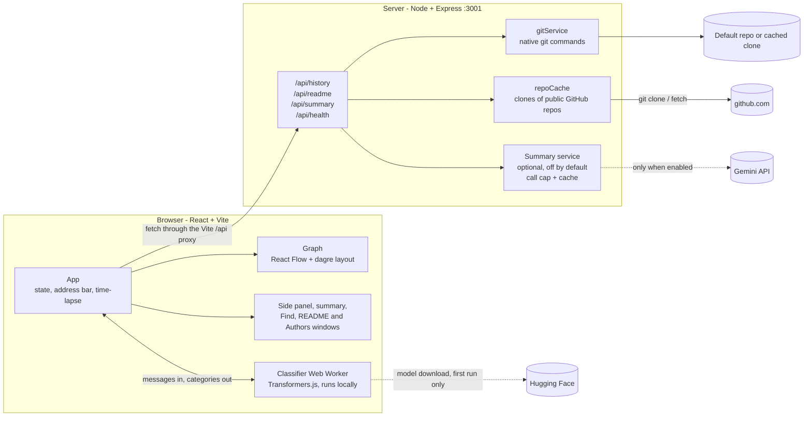

# Commit Explorer

> Turns any public GitHub repo's commit history into an explorable Windows XP-style graph: size shows how much changed, colour shows what kind of change it was, and a time-lapse replays how the project grew.

A normal `git log` is a long wall of text. Commit Explorer draws the same history as a map you can pan, zoom, search and play back, so you can see where the big changes happened, who made them and what kind of work each commit was, without reading a single diff.

## Features

The entire experience is wrapped in a nostalgic Windows XP interface, complete with the classic boot screen, startup sound, and retro windows, buttons, and taskbar.

To get started, you can load any public GitHub repository just by pasting its URL into the address bar. If you leave it blank and hit Go, it defaults to showing you this project's own history. Once a repo loads, you'll see the commits represented as windows. Their physical size actually reflects their impact—massive code dumps or major refactors take up a ton of space, while quick one-line fixes are tiny. There's a legend included so you always know the scale.

It handles real-world repos beautifully, mapping out every branch and merge commit (with merges clearly showing every parent). For extremely large projects, it automatically caps at the newest 500 commits and lets you know. It keeps performance smooth by only rendering the nodes currently visible on screen, and gives you a minimap and zoom controls to navigate the canvas. If the backend ever drops out, it gracefully falls back to sample data and alerts you so you aren't left guessing.

Down in the XP taskbar, there's a time-lapse player. Hit play, and the graph physically builds itself commit by commit over about a minute while the camera tracks the newest additions. You can also grab the slider to scrub back and forth through time at your own pace.

If you're hunting for something specific, a Ctrl+F style search box next to the address bar lets you dig through commit messages, author names, and hashes. It highlights your matches, dims everything else, and lets you step through them with the Enter key. Clicking on any commit node slides out a detailed panel containing the full message, hash, author, date, lines added and removed, its category, and parent commits.

There is also a local AI built right into the browser that categorizes everything without needing an account or API key. It automatically tags and color-codes every commit as a Feature, Bugfix, Refactor, or Chore. In the details panel, you can also hit the "Generate summary" button to get a plain-English explanation of what a specific commit actually did. (Check out the "How the AI works" section for more details on both of these).

Finally, a couple of desktop icons in the top right round out the workspace. One opens the repo's README in a classic Notepad-style plain text window (which stays blank if the repo doesn't have one). The icon right below it pulls up an Authors window, giving you a full breakdown of everyone who contributed, how many commits they made, and their overall slice of the project's history.

## How the AI works

Commit Explorer uses AI in two separate places. The first is always on and fully local. The second is optional and off by default.

### 1. Commit classification (always on, runs in your browser)

- **Model:** a small zero-shot classifier, `Xenova/mobilebert-uncased-mnli`, run with [Transformers.js](https://github.com/huggingface/transformers.js) inside a Web Worker so the page never freezes while it loads or works.
- **How it decides:** for each commit message it scores four labels ("bug fix", "new feature", "code refactoring", "chore") and keeps the best one if it is at least 40% confident. Otherwise the commit stays Unclassified rather than guessing.
- **Shortcuts:** messages that start with "merge" or mention a README are marked Chore, and one-word messages are left Unclassified.
- **Privacy:** commit messages never leave your browser for this. The model files are downloaded once from Hugging Face the first time the app loads (so that first run needs internet) and are cached by the browser afterwards.
- **If it can't load:** the graph still works. Nodes stay the default blue, and the side panel shows "AI offline" in place of a category. Colours appear as results come in.
- **Limits:** it judges the message text only, not the code, so vague messages like "fix stuff" can be misread.

### 2. Commit summaries (optional, off by default)

Clicking **Generate summary** on a selected commit shows a short plain-English description. What you get depends on whether Gemini is switched on.

| | Gemini off (the default) | Gemini on |
|---|---|---|
| What you see | A basic summary built in the browser from the commit's own data | A 2–3 sentence summary written by Google Gemini |
| Example | "A medium change that adds 120 lines and removes 14 lines. Made by Khizar Ali Khan on 25 October 2026." | A short description of what the commit changes and why it matters to someone new to the project |
| Calls to Gemini | None | The server calls the Gemini API |
| Caption under the text | "Basic summary - AI is switched off" | None |

- **Off by default.** Summaries only use Gemini when `GEMINI_ENABLED=true` is set **and** a key is present in `server/.env`. With nothing configured, no request is ever made. Setup is in [SETUP.md](SETUP.md).
- **What is sent when it is on:** the commit message, author, date, parent count, and the names and line counts of up to 25 changed files. File contents are never sent. The commit text is passed as data, with instructions to ignore anything in it that reads like a command.
- **The key stays on the server.** It lives only in the git-ignored `server/.env`, is never sent to the browser and is never logged.
- **Cost guard-rails.** The server makes at most 30 Gemini calls per run by default, and caches each summary so asking again for the same commit costs nothing.
- **It fails safe.** If Gemini is unreachable or the call limit is hit, the panel shows the basic summary with the caption "AI unavailable - showing basic summary".
- **The long wait is on purpose.** The summary button plays a retro loading screen with sound for about 21 seconds, with AI on or off. It is part of the XP theme, not lag.

## Run it

You need [Node.js](https://nodejs.org) 20 or newer and `git` installed.

```bash
npm run install:all
npm run dev
```

Then open http://localhost:5173. The first load needs internet so the classifier model can download. Loading other repos from GitHub needs internet too. See [SETUP.md](SETUP.md) for choosing a different repo, ports and the optional Gemini setup.

## Architecture



- **The server reads, the browser draws.** The server runs native `git` commands and returns a flat JSON array of commits (id, parents, author, date, message, lines added and deleted). The browser turns that into nodes and edges, lays them out with dagre and draws them with React Flow.
- **Classification never touches the server.** The Web Worker gets the commit messages from the page and sends categories back.
- **Picked repos are cached.** Public GitHub repos are cloned once into `server/.repo-cache` and updated on later loads. Only `https://github.com/owner/repo` addresses are accepted.
- **Built with:** React 19, Vite, React Flow (`@xyflow/react`), dagre, Tailwind CSS 4, Transformers.js, Node.js and Express 5. Gemini is used only for the optional summaries.

| Endpoint | What it does |
|---|---|
| `GET /api/history?repo=&limit=` | Commits from every branch, newest first |
| `GET /api/readme?repo=` | The repo's README text |
| `POST /api/summary` | Gemini summary of one commit (503 while AI is off) |
| `GET /api/health` | Server status and whether AI is on |

The full request and response details are in [SETUP.md](SETUP.md).

## Challenges

- **Parsing real git output.** Commit messages can contain pipes, quotes, emoji and anything else a simple parser would split on. The server separates fields with a control character instead, and the parser has tests for these cases, merge commits, binary files and Windows line endings.
- **Making size mean something without hiding the text.** Scaling a node by lines changed worked until the smallest commits became too short for their own message. Node height now comes from the text size, so even a one-line commit stays readable.
- **Three people building in parallel.** The repo picker and the Find box both wanted the same spot on the screen. We merged them into one shared toolbar and kept both features.
- **Honest limits for a small local model.** Judging intent from a short message is hard, so low-confidence commits are left Unclassified instead of being given a confident wrong colour.
- **Optional cloud AI in a public repo.** The Gemini key never leaves the server and is git-ignored, calls are capped, results are cached, and everything works with the feature switched off.
- **Big histories.** The graph shows the newest 500 commits, draws only what is on screen, and says clearly when it has trimmed a repo.

## What's next

- **Smarter classification.** Use conventional-commit prefixes such as `fix:` and `feat:` first, and look at which files changed (tests, docs, config) as well as the message.
- **Merge duplicate authors.** The Authors window groups by name, so someone who commits under two names appears twice. Matching on email or a `.mailmap` file would fix that.
- **Filters.** Narrow the graph by category, author or date range, and label branches and tags on the nodes.
- **Dig into a commit.** Show the diff in the side panel and link each node to its page on GitHub.
- **Bigger repos.** Load history in pages instead of the newest 500, and fold long runs of simple commits together.
- **More sources.** Support private repos with a token, other hosts such as GitLab, and a picker for local folders.
- **Share the story.** Export the time-lapse as a GIF or video.
- **Nicer README window.** Render the repo's README as formatted Markdown instead of plain text.

## Team

- [Khizarali007](https://github.com/Khizarali007)
- [Modblitz](https://github.com/Modblitz)
- [sreyas-sreekumar](https://github.com/sreyas-sreekumar)

